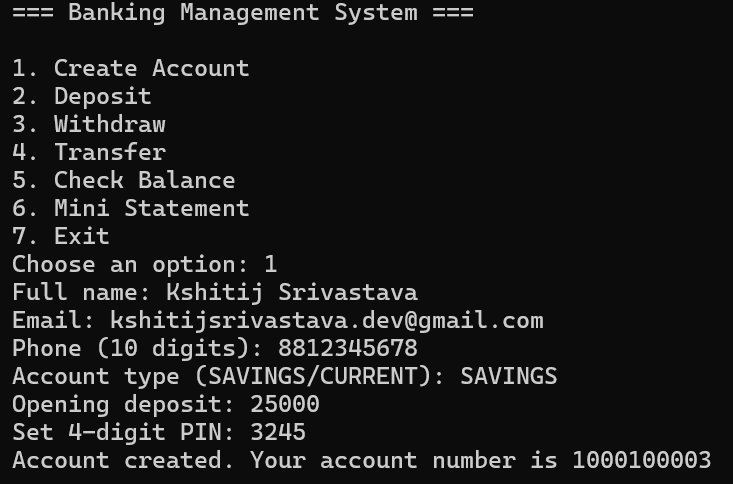
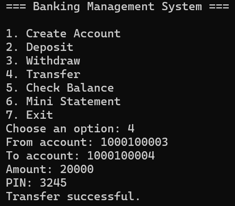
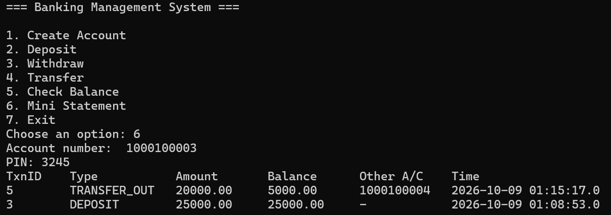

# Banking Management System

A console-based banking application built with **Java, JDBC, and MySQL**.

I built this project to practice Java OOP, JDBC, SQL, database transactions, and exception handling in a practical application. The system supports basic banking operations such as creating accounts, depositing and withdrawing money, transferring funds, and viewing transaction history.

## Features

- Create customer and bank accounts
- Opening deposit while creating an account
- Deposit and withdraw money
- Transfer money between accounts
- Check account balance
- View the last 10 transactions
- 4-digit PIN authentication
- Input validation for customer and transaction details
- Custom exception handling
- JDBC transactions with commit and rollback
- Row-level locking during fund transfers
- SQL queries using `PreparedStatement`

## Tech Stack

- **Java 17+**
- **JDBC**
- **MySQL 8+**
- **MySQL Connector/J**
- **Git & GitHub**

## How It Works

The application is organized into separate layers so that the console interface, business logic, and database operations are not mixed together.

```text
User
 │
 ▼
Main.java
(Console Menu)
 │
 ▼
BankService
(Business Logic)
 │
 ├───────────────┐
 ▼               ▼
AccountDAO   TransactionDAO
 │               │
 └───────┬───────┘
         ▼
      MySQL
      bank_db
```

### Main Components

| Component | Purpose |
|---|---|
| `Main` | Console menu and user input |
| `BankService` | Handles banking operations and business rules |
| `AccountDAO` | Account-related database operations |
| `TransactionDAO` | Transaction-related database operations |
| `DBConnection` | Creates JDBC database connections |
| `Validator` | Input validation and PIN hashing |
| `model` | Account and transaction data objects |
| `exception` | Custom application exceptions |

## Database

The project uses three main tables:

```text
customers
    │
    │
    ▼
accounts
    │
    │
    ▼
transactions
```

### `customers`

Stores basic customer information such as name, email, and phone number.

### `accounts`

Stores account number, customer ID, account type, balance, and hashed PIN.

### `transactions`

Stores deposits, withdrawals, and transfers along with the balance after each transaction.

The complete database schema is available in:

```text
sql/schema.sql
```

## Screenshots

### Account Creation



### Fund Transfer



### Mini Statement



## Running the Project

### Prerequisites

Install the following:

- Java 17 or later
- MySQL Server 8 or later
- MySQL Workbench
- MySQL Connector/J

### 1. Create the Database

Open:

```text
sql/schema.sql
```

in MySQL Workbench and execute it.

This creates the `bank_db` database and its tables.

### 2. Add MySQL Connector/J

Download MySQL Connector/J and place the `.jar` file inside:

```text
lib/
```

For example:

```text
lib/
└── mysql-connector-j-26.7.0.jar
```

The JAR is not included in the repository because it is excluded through `.gitignore`.

### 3. Configure MySQL

The application uses:

```text
Host:     localhost
Port:     3306
Database: bank_db
User:     root
```

Set your MySQL password before running the application.

On Windows Command Prompt:

```cmd
set DB_URL=jdbc:mysql://localhost:3306/bank_db
set DB_USER=root
set DB_PASS=your_password
```

Replace `your_password` with your local MySQL password.

### 4. Compile

Run the included compilation script:

```cmd
compile.bat
```

This compiles the Java source files into the `out` directory.

### 5. Run

```cmd
java -cp "out;lib/*" com.bank.Main
```

The application will open a console menu:

```text
=== Banking Management System ===

1. Create Account
2. Deposit
3. Withdraw
4. Transfer
5. Check Balance
6. Mini Statement
7. Exit
```

## Some Implementation Details

### JDBC Transactions

Operations involving multiple database changes use JDBC transactions. Changes are committed when the operation succeeds and rolled back if something goes wrong.

For example, a fund transfer involves updating both accounts and recording the corresponding transactions.

### PreparedStatement

Database queries use `PreparedStatement` instead of directly inserting user input into SQL statements.

### Transfer Locking

During a transfer, the relevant account rows are locked using `SELECT ... FOR UPDATE`. This helps prevent two concurrent operations from modifying the same balances at the same time.

### PIN Handling

The application does not store the PIN directly. The entered PIN is hashed before being stored in the database.

## Project Structure

```text
BankingSystem/
│
├── docs/
│   └── screenshots/
│       ├── create-account.png
│       ├── transfer.png
│       └── statement.png
│
├── lib/
│
├── sql/
│   └── schema.sql
│
├── src/
│   └── com/bank/
│       ├── Main.java
│       ├── model/
│       ├── dao/
│       ├── service/
│       ├── db/
│       ├── util/
│       └── exception/
│
├── .gitignore
├── compile.bat
└── README.md
```

## Future Improvements

Some things I would add in a larger version of the project:

- JUnit tests
- Spring Boot REST API
- Web-based interface
- Admin dashboard
- Account statement export
- Interest calculation

## Author

**Kshitij Srivastava**

[GitHub](https://github.com/kshitijsrivastava-dev)